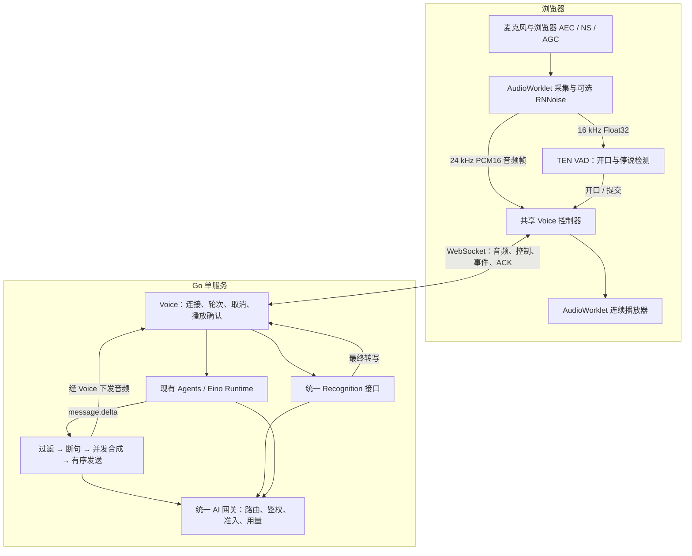
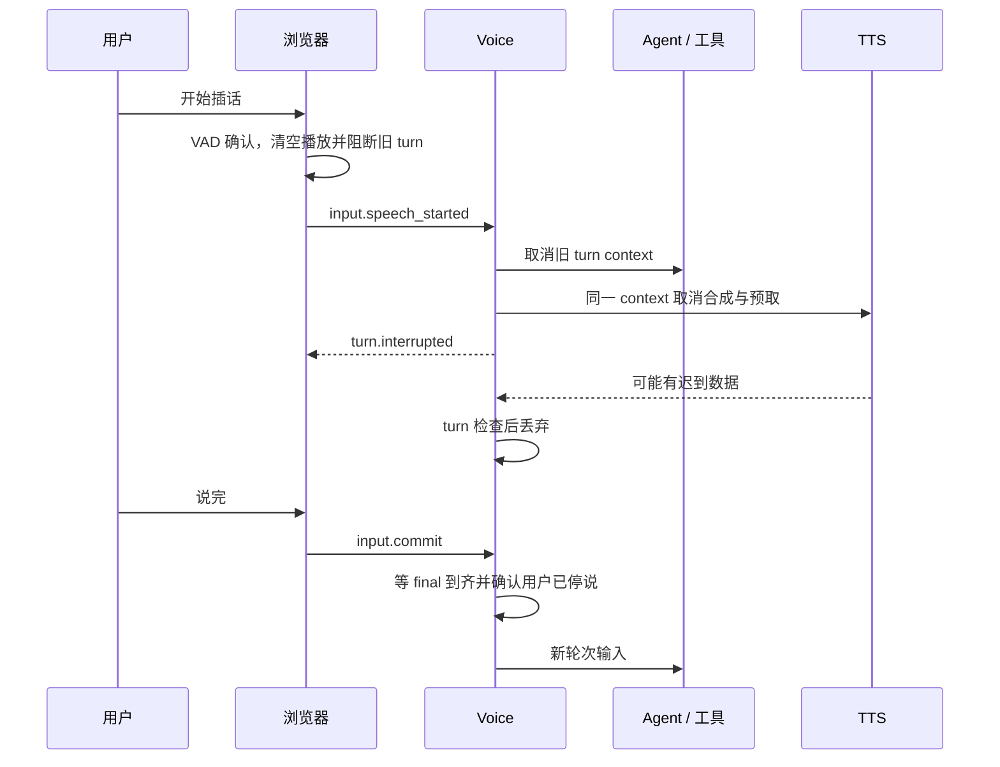

# DraftGo 实时语音 Agent 处理层实现详解

> 面向希望在其他项目中复用语音交互经验的开发者。本文讲现有系统如何工作、为什么这样做，以及哪些实现细节直接影响听感和交互稳定性。
>
> 整理日期：2026-10-15。依据：`draftgo/` 当前源码，读取时 Git HEAD 为 `eed72d1`。本文只做源码分析，没有修改业务源码，没有调用真实模型或进行本次性能实测。下文时间、大小和并发数均为当前实现参数，不代表任何部署环境的性能保证。

建议阅读路线：先看整体架构，再看流式输出、连续播放、插话与已听历史；需要移植时看第 22 节，需要对照实现时看第 24 节。

- [整体架构](#architecture)与[音频输入](#capture)
- [轮次协调](#turns)与[流式输出流水线](#streaming)
- [连续播放](#playback)、[插话取消](#interruption)与[播放确认／历史](#delivery)
- [延迟度量](#latency)、[迁移步骤](#migration)与[源码地图](#sources)

## 1. 先明确：我们现在做的是哪一种实时语音

当前 Agent 实时通话的核心架构是可组合的 **ASR → Agent LLM → TTS**：

- ASR（Automatic Speech Recognition）：把用户声音转成文字。
- Agent：使用现有智能体运行时理解文字，执行知识检索、工具调用、确认和回复生成。
- TTS（Text-to-Speech）：把适合朗读的模型输出合成为音频。

“实时”来自输入采集、转写、模型输出、语音合成和播放各环节的增量处理，以及贯穿整条链路的轮次协调。并不是把一段录音上传、等完整回答、再下载一份音频。

需要区分三个现有入口：

| 能力 | 作用 | 是否调用 Agent | 主要传输 |
| --- | --- | --- | --- |
| 语音输入／听写 | 识别后回填可编辑草稿 | 否 | 分段音频 HTTP 上传 |
| 实时通话 | 持续听说、调用工具、多轮交互 | 是 | 浏览器与 Voice 服务之间的 WebSocket |
| 输出朗读 | 跟随或重放一个已有运行的输出 | 不重新调用 Agent | HTTP SSE，复用语音输出流水线 |

仓库还有 `/api/v1/realtime` 等原生实时模型代理入口。那条路径用于供应商实时协议接入，**不等于本文的 Agent 通话已经切换为原生端到端语音模型**，也不能因此推断它已接入现有 Eino 工具治理。`task/voice-realtime-design.md` 是双模式与摄像头的目标方案，其“尚未实施”内容不能当作当前能力。

目前输入上传和输出下载可以同时进行；轮次交互则采用明确的发言权切换：用户开口后取消当前可打断回复，再等待新输入完成。这里的“全双工传输”不表示模型会同时理解并持续回应两个人重叠讲话，也不表示 ASR 能保留全部语调、情绪和声学信息。

<a id="architecture"></a>

## 2. 总体架构：把媒体、轮次、智能体和模型出口分开



这套实现没有引入第二个 Python 语音服务，也没有为了通话再做一套独立 Agent 编排器。浏览器、Voice、Agent Runtime 和 AI 网关各自承担稳定的职责：

| 层 | 核心职责 | 不应混入的职责 |
| --- | --- | --- |
| 浏览器媒体层 | 设备权限、降噪、重采样、VAD、连续播放 | 选择供应商密钥、判断业务工具是否获批 |
| Voice 处理层 | 管连接与轮次，协调 ASR、Agent、TTS，传播取消，核对播放 | 直接实现各厂商全部协议、另写业务工具编排 |
| Agent Runtime | 提示词、知识、记忆、工具、确认与恢复 | 处理 PCM 包边界、控制声卡播放 |
| AI 网关与适配器 | 模型选路、协议转换、调用准入、用量和计费 | 决定页面如何展示通话状态 |

Voice 通过 `Agent`、`Media`、`Recognition` 等 Go 接口依赖外部能力，启动装配层负责桥接。这样 ASR 和 TTS 可以独立更换，Agent 的主要业务能力仍走原有路径。

## 3. 一次通话从建立到结束

### 3.1 能力检查与固定配置

管理端保存的 Agent 配置决定是否允许通话、识别模型、合成模型、音色、语言、风格及是否可打断。前端不能在每次上传音频时任意替换模型或音色。

能力接口会检查：

- Agent 本身是否可调用，用户是否具备访问资格。
- Agent 输出是否适合语音：当前通话要求文本输出，不能强制 JSON。
- 输入 schema 是否接受任意自然语言文字。
- ASR 是否具有平台已实现、当前可用的识别出口。
- TTS 是否具有当前通话要求的流式 PCM 出口。

ASR 未显式选择时可以使用系统默认 ASR；通话 TTS 必须配置。供应商名字或模型名字里有 `realtime`，不等于它具备合格的增量识别协议。

通话创建时解析 Agent 快照并形成配置 revision。连接建立前再检查一次；通话中每 15 秒复核身份、平台开关、模型可用性和 revision。配置变化会结束当前通话，要求重新发起，不在一通电话中途悄悄更换大脑或说话人。

### 3.2 短时票据与连接

主要 HTTP 入口：

| 方法与路径 | 用途 |
| --- | --- |
| `GET /api/agents/{agent_id}/voice-capabilities` | 查询语音输入、朗读、通话能力及不可用原因 |
| `POST /api/voice/sessions` | 创建通话，取得短时票据和连接地址 |
| `GET /api/voice/sessions/{session_id}/connect?ticket=...` | 使用票据升级 WebSocket |
| `GET /api/voice/sessions/{session_id}` | 查询通话状态 |
| `POST /api/voice/sessions/{session_id}/end` | 结束通话 |

创建请求可以携带 `agent_id`、`session_key`、`idempotency_key` 和 `turn_detection`。官方浏览器控制器默认申请 `client` 检测；直接调用 HTTP 创建时省略该字段，服务端默认 `server`。

票据有效期为 1 分钟，消费后失效。连接 URL 使用短时票据，长期登录凭据不放进 URL。创建和查询等 HTTP 操作仍走正常身份认证。前端还会检查连接地址同源。

建立连接后，Voice 打开 ASR，必要时等待上游会话配置确认，再发送 `session.ready`。不是浏览器 WebSocket 的 `open` 一触发，就代表上游识别已经准备好。

当前通话最长 30 分钟，使用心跳和读写超时检测断线。会话内存态不承诺跨进程重启恢复。异常断开后由用户重新发起，不自动重传旧音频，也不自动重跑可能已执行的工具。

### 3.3 为什么所有前端入口共用一个控制器

`draftgo-voice.js` 统一负责采集、VAD、WebSocket、播放、字幕与状态；Chat 和独立通话组件消费它的高层事件。

这避免不同入口分别维护音频队列、重复占用麦克风、用不同规则打断，或者一个入口按“收到音频”确认播放、另一个入口按“实际播完”确认播放。采集层还有麦克风所有权检查，同一执行环境中不能同时启动两个录音 owner。

<a id="capture"></a>

## 4. 输入音频处理：把格式、线程和降噪做对

### 4.1 统一的内部媒体格式

通话音频约定为 **PCM16LE、24000 Hz、单声道**。

| 项目 | 数值 |
| --- | --- |
| 每秒样本数 | 24000 |
| 每个样本 | 2 字节，有符号 16 位、小端 |
| 每秒原始数据 | 48000 字节，约 384 kbit/s |
| 默认上传帧 | 20 ms，480 个样本，960 字节 |
| 单个上传二进制消息上限 | 48000 字节，即最多 1 秒 PCM |

这只是原始 PCM 数据量，尚未计 WebSocket、TLS、JSON 和 base64 等开销。浏览器到服务端上传用二进制 PCM；服务端到浏览器的音频封装为 JSON 事件中的 base64，因此下行还存在编码开销。

不能把浏览器默认 48 kHz 的 Float32 数据直接当成 24 kHz PCM16 发送，也不能把 MediaRecorder 的 WebM/Opus 包当成 PCM。采样率误配会造成语速、音高、时长和识别质量异常。

### 4.2 采集放在 AudioWorklet

浏览器申请麦克风时启用单声道、回声消除、噪声抑制和自动增益控制。采集上下文优先申请 48 kHz，以适配 RNNoise；部分浏览器拒绝该采样率时，回退到设备原生采样率。

音频渲染线程中的 worklet 连续接收样本、混合声道、处理降噪与重采样，再输出两路数据：

1. **24 kHz PCM16，20 ms 一帧**：上传给服务端 ASR。
2. **16 kHz Float32，512 样本一帧，即 32 ms**：送浏览器 VAD。

两个分支源自同一条处理后的音频，避免 VAD 在原始噪声上判定、ASR 却收到另一种音频。主线程只处理消息与网络发送，不承担逐样本处理。

### 4.3 重采样保留历史与相位

采集和播放共用有状态的 windowed-sinc 重采样实现，包含低通滤波和 Blackman 窗。

关键点是：**重采样器跨音频包持续存在**。网络包边界不是声音的物理边界。每个包重新初始化滤波器，会丢掉历史、打断相位，造成边缘失真、杂音或不连续。

采集把输入采样率转换为 24 kHz 和 16 kHz；播放则把 24 kHz PCM 转到设备 AudioContext 的实际采样率。设备不必刚好工作在 24 kHz。

### 4.4 RNNoise 是可选增强，不能成为通话单点

浏览器处理后，可选再经过本地 RNNoise。它以 48 kHz、480 样本／10 ms hop 处理，使用的是 int16 幅度范围的浮点值；代码明确做了 Web Audio `[-1,1]` 与该幅度范围之间的转换。

RNNoise 按需加载，准备超时预算为 1500 ms。WASM 不可用、初始化失败或模块无法传给 worklet 时，保留浏览器自身处理继续通话。

需要区分三个问题：降噪减少背景噪声，AEC 处理扬声器回传，VAD 决定何时认为用户在讲话。它们互相配合，但不能互相替代。输入侧 AGC、降噪也不应用于 TTS 输出，避免改变合成声音。

## 5. 轮次检测：先判断谁在说话，再判断说了什么

### 5.1 浏览器 TEN VAD：默认路线

浏览器使用 TEN VAD 的 WASM 实现。每个 512 样本的 16 kHz 帧拆成两个 256 样本 hop，取人声概率的平均值。

检测不仅看概率，还看当前 RMS 是否超过自适应底噪：

| 条件 | 普通聆听 | 正在播报或回声保护期 |
| --- | --- | --- |
| 开口人声概率 | 大于 0.5 | 大于 0.8 |
| 连续满足时间 | 至少 150 ms | 至少 250 ms |
| 相对底噪能量门槛 | 大于底噪的 1.35 倍 | 大于底噪的 1.8 倍 |
| 绝对能量下限 | RMS 0.00015 | RMS 0.00015 |
| 停说 | 概率低于 0.35，或能量不足，持续至少 300 ms | 同左 |

这些是逻辑门槛，实际动作按 32 ms 帧累计触发，不是精确到 1 ms 的定时器。

底噪仅在未讲话、且模型较确定为非人声时学习；噪声下降较快跟随，上升较慢，避免把小声说话迅速学成噪声。播报结束或清空后还有 350 ms 回声尾音保护。

确认开口后立即发 `input.speech_started`；确认停说后发 `input.commit`。VAD 准备失败或超过 6 秒加载预算时，创建通话改用 `server` 检测。

VAD 判断的是声学上的人声和停顿，不是语义上的“这句话已经表达完整”。当前没有据此承诺复杂的语义端点检测，也没有把“嗯”“对”自动分类成可恢复旧回复的附和。

### 5.2 服务端分段识别的能量 VAD：兜底路线

当使用文件转写适配器且检测模式为 `server` 时，服务端按 20 ms 音频帧计算 PCM RMS：

- 阈值为 `max(600, 底噪 × 3)`，这里 600 使用 int16 幅度尺度，不能与浏览器归一化 RMS 混用。
- 连续 6 帧，即 120 ms 超过阈值，判定开口。
- 连续 25 帧，即 500 ms 静音，判定停说。
- 前 500 ms 的非人声帧快速校准底噪，之后使用权重 0.05 的 EMA。
- 预计正在播放 Agent 音频时，门槛再乘 1.5，降低回声误触发。
- 保留 400 ms 前置音频，覆盖开口确认窗口和渐强起音。

在浏览器 `client` 模式中，本地分段识别器跟随客户端边界，开口时保留约 200 ms 前置音频，不再用这套能量 VAD 重新划分说话边界。

若 ASR 走原生 WebSocket，`server` 模式的 VAD 可能由上游执行，不能把本节参数视为所有 ASR 路由的统一参数。StepFun 在 `client` 模式中特意不启用第二层上游 VAD，避免浏览器已经 commit 后，上游还在等待另一段静音。

## 6. ASR 适配：外部协议不同，内部生命周期一致

Voice 使用统一 `Recognition` 接口：`SendAudio`、`Commit`、`Clear`、`ReadEvent`、`Close`。上游差异被隐藏在适配层，轮次控制不必到处判断厂商品牌。

### 6.1 路线 A：文件 ASR 包装成持续通话

即使供应商只支持上传完整 WAV，也能用于持续电话：浏览器连续上传 PCM，由本地适配器封段，再把每段包装成 WAV 调用文件转写。

当前实现的重点：

- 单段最多 15 秒，包括尾部静音；长讲话自动封段。
- 最多 2 路识别并发，结果仍按封段顺序交付。
- 待识别段队列容量为 6；满时丢弃最旧的尚未开始段，记录告警，保留通话连接。
- `Clear` 递增 generation，取消旧代识别上下文并清空缓冲。
- 已经返回但尚未被轮次层接纳的旧结果，也必须再次检查是否仍有效。

两个识别请求同时跑，第二个可能先返回。实现为每个段分配结果通道，再由一个按封段顺序消费的汇总器交付，保证“先说的话”不会排到后面。代价是后段可能等待前段，这比乱序理解用户输入更可控。

这条路线在浏览器到服务端层面持续流式上传，但供应商识别是分段整包请求，通常只产生最终字幕。不能因此宣传为供应商原生边录边出字。

### 6.2 路线 B：原生增量 WebSocket ASR

当有效模型出口具备平台已实现的可复用增量识别生命周期时，网关直接建立上游 WebSocket，持续追加音频，归一化为临时和最终转写事件。

实现细节比“连接上就转发”更多：

- 按明确的 capability、operation、transport 和出口 ID 选路。
- 音频格式由服务端固定，客户端不能改成另一种模型或工具会话。
- StepFun 默认采样率与通话格式不一致，必须等 `session.updated` 确认 24 kHz 配置生效，再向浏览器宣布准备好。
- 临时字幕可能是累计快照和纠错，不一定是纯追加 delta。收到 `snapshot` 时用完整 `transcript` 替换，避免把纠正后的前缀再拼一遍。
- 某些上游没有 clear：StepFun 使用 commit 封口，再抑制已取消范围的识别结果；已发生的 usage 仍然保留。
- commit 确认事件和最终转写可能使用不同 item ID，需要根据提交顺序和终态关联。

跨 DraftGo／Routergo 转发时，如果继承的上游生命周期不能明确确定，内部电话保留 HTTP 分段识别；明确固定到已支持的可复用 WebSocket 合同时才使用对应增量管线。公开转写可用的出口范围与内部多轮电话可用的出口范围不是同一件事。

### 6.3 临时字幕不启动 Agent

`transcript.partial` 只负责即时反馈，真正进入 Agent 的是有效、去重、已协调好轮次的 final。

原因是临时结果会纠错，用户也可能继续说。提前用 partial 执行工具，可能把“不要取消”在识别尚未稳定时当成“取消”，也会不断制造被推翻的模型轮次。

<a id="turns"></a>

## 7. 轮次协调：避免抢答、重复输入和旧结果污染

### 7.1 “拿到 final”与“用户说完”是两个条件

处理层分别维护用户是否仍在讲话、已经开始的语段数、已经完成的识别数、待接纳文本，以及当前输入 generation。

只有同时满足以下条件，才开始新的普通回复：

1. 用户当前不在讲话。
2. 当前需要的最终转写已经到齐。
3. 合并后的文字不为空，且输入仍属于当前 generation。
4. 没有阻止新普通轮次的待确认操作。

例如：

```text
用户说 A → 停顿 → 用户开始 B → A 的 final 此时才返回

正确：保留 A，继续听 B，B 停说且识别到齐后再处理。
错误：A 一返回就播放回复，与正在讲话的 B 重叠。
```

在 `client` 模式中，用户边界以浏览器的开口与 commit 为准。ASR 自己迟到的停止事件不能结束下一段用户讲话。

本地文件 ASR 还会遇到长讲话自动拆成多个段、空识别或队列丢段，因此不能简单假设“一次开口恰好对应一个 final”。它提供实际待处理任务计数，并在轮次层接纳结果的同一把锁内释放任务，避免出现“计数先归零，文字还没加入”的抢答窗口。

### 7.2 短暂停顿切开的句子可以合并

用户可能说“帮我查一下”，短暂停顿后接“明天上海的天气”。当前实现允许在很窄的条件下，将两段当作一次完整输入：

- 后一次开口距前一次停说不超过 1200 ms。
- 前一轮尚未产生任何模型文本或发出音频。
- 前一轮仍在执行，或者因这次开口被硬取消，仍符合连续输入条件。

符合条件时，新轮次输入拼接前后两段，并在 `transcript.final` 带 `replaces_turn`，让前端替换被取代的用户气泡。模型上下文构建也处理这种前缀重复，避免同时保留一份短输入和一份包含它的长输入。

已经开始回答的轮次不做这种拼接。否则用户真正改变话题时，系统会错误地把两件事合成一个请求。

### 7.3 Agent 串行，取消收尾有界

同一通话内的 Agent 执行用 `runMu` 串行，避免两个轮次同时改变同一会话状态。另有容量为 2 的 worker 通道，容纳被取消轮次的收尾与后继轮次的有限等待；申请槽位超过 3 秒会触发 `turn_backpressure`。

这是对取消需要时间的现实处理。取消信号已经发出，不代表旧工具、模型连接、合成任务和记录收尾都已立即退出；不能无限启动 goroutine 等待它们。

### 7.4 输入 generation 与输出 turn_id 分开

输入 generation 用于淘汰 clear、静音或取消输入之前的识别结果；`turn_id` 用于淘汰旧回复的文字、音频和控制事件；commit sequence 则决定合并输入使用哪一份参考资料快照。

这三个标识解决的问题不同。只靠一个“当前是否忙碌”的布尔值，很难安全处理识别完成、用户开口、清空输入和新轮次启动之间的竞态。

## 8. Agent 处理：复用业务能力，只对语音做运行期优化

Voice 最终通过启动装配层调用现有 `agents.Service.Invoke`，传入共享 `session_key`、最终识别文本、`Stream=true` 和 `Voice=true`。工具仍走现有 Agent Runtime／Eino，保留原来的权限、预算、确认与恢复。

### 8.1 语音专用运行参数

语音调用在内存里的运行快照上覆盖部分配置：

| 参数 | 当前策略 | 目的 |
| --- | --- | --- |
| Reasoning effort | 请求 `off` | 减少不适合电话等待的推理开销；实际支持取决于模型适配 |
| 最大输出 token | 不超过 400；已有更小限制继续保留 | 避免一次说太长 |
| 最大模型轮数 | 不超过 6；更小的编排限制继续生效 | 约束工具循环与等待 |
| 始终检索型知识查询 | 每个绑定单独设 800 ms 超时 | 慢检索不无限阻塞语音首句 |

这不是修改 Agent 保存配置。一次语音通话的运行参数不应永久改变普通文字聊天。

知识检索超时且父上下文仍有效时，本轮跳过该项，写日志和 span；其他类型的检索错误不能一概当超时吞掉。这里存在明确取舍：响应速度提高，但本轮可能缺少该知识库证据；如果业务要求“无证据就不能回答”，应在业务规则和模型行为中明确限制。

### 8.2 首个模型请求前的准备工作并行

语音轮次将“提示词／知识／相关 Skill 加载”和“工具发现”并行准备，再汇合进入模型请求。两者各自有独立数据来源，重叠等待能减少串行累积时间。

结果仍保持既有工具顺序、每轮读取和权限语义。优化的是独立准备工作的等待，不是取消必要验证，也不是把所有数据永久缓存。

### 8.3 提示词先约束，再用处理层兜底

语音提示词要求口语、短句、先结论，一次 1～3 句；不要输出 Markdown、代码、表格、网址和舞台动作；数字单位按口语表达；需要工具时直接调用，拿到真实结果再回答。

等待提示由平台处理，模型不必为了“显得自然”先生成一段“我查一下”再调用工具。这样可以少一次文本／语音等待，也避免工具尚未执行就编造结果。

仅写提示词仍不够：模型可能违反格式，历史也可能带入旧内容，所以输出前还有独立、确定性的可朗读过滤器。

<a id="streaming"></a>

## 9. 输出流式流水线：模型文本与声音彻底解耦

每个轮次创建独立的 `speechPipeline`：

```text
Agent message.delta
        ↓
可朗读过滤器 speakable
        ↓
文本断句器 chunker
        ↓
待合成片段队列
        ↓
最多 3 段并发 TTS
        ↓
按片段顺序发送 PCM
        ↓
浏览器连续播放 → 按片段 ACK
```

模型事件到达后，一份完整原文继续以 `agent.event` 交给聊天界面；另一份送入语音流水线。朗读过滤不修改原始回答，聊天仍可展示代码和完整文字。

`Ingest` 不等待网络合成或播放确认。它在锁保护下完成文本处理和有界入队，后台负责断句检查、合成调度和发送。否则把“等用户听完一句”放在模型流读取回调里，会反向阻塞上游流，带来积压、超时和明显停顿。

这里的非阻塞指不等待合成和播放，并不意味着没有锁、没有处理成本。队列必须有上限，不能靠无限堆文本维持这种解耦。

## 10. 可朗读过滤：保留内容，去掉不适合说出来的形式

`speakable` 是跨增量的状态机，不是一条正则表达式。模型增量可能切在 UTF-8 字节中、代码围栏中、Markdown 链接中，或者括号标签中；在结构尚不明确时，需要暂存少量文本等待后续。

| 模型输出形式 | 语音处理 |
| --- | --- |
| 标题、粗体、斜体、引用、列表标记 | 去掉格式，保留可说的内容和停顿 |
| 行内代码 | 去掉反引号，保留内容 |
| 代码块 | 整块跳过，每轮首次替换为“代码我发在聊天里了。” |
| Markdown 表格 | 整表跳过，每轮首次替换为“表格我放在聊天里了。” |
| `[文字](链接)` | 读文字，不逐字符读 URL |
| 裸 URL | 首次给“链接已发在聊天里。”提示，之后跳过 |
| 表情、装饰符 | 丢弃 |
| 简短动作或舞台描述 | 识别后丢弃，避免读出“笑着说”“挠头”等 |
| 允许的语气标签 | 仅在路由支持且配置允许时交给 TTS；字幕中移除 |
| 内部播报／送达标记 | 静默去除，不生成额外替代提示 |

其中动作和结构判断是启发式规则，不是任意自然语言的完美语义分类器。实现还保留普通括号补充说明的口语表达，不能简单删除所有括号内容。

每轮对代码、表格、链接分别最多生成一次替代提示，避免模型输出多个链接时，用户反复听到同一句平台说明。

这层过滤同时影响传给 TTS 的文本、播放字幕及后续已听记录。原始聊天文本继续保留，便于用户查看具体内容。

## 11. 流式断句：首声速度与完整表达之间的平衡

不能把每个 token 立即独立送 TTS。中文 token 可能很短，英文单词和数字可能跨多个 delta；每几个字发起一次合成，会引入反复起音、音色漂移、断句错误和更多请求成本。

也不能等整轮模型结束再合成，否则所有生成时间都进入用户等待。

### 11.1 先按完整句切，后续段允许顺手合并

断句优先识别中文句号、问号、叹号、换行等完整边界。英文句点需要结合后续字符判断，避免把小数点当句末；省略号也会等待必要后文。

普通短句里的逗号、顿号和列举，不立即切成多个请求。超过 60 个 rune 时尝试退到软标点；达到 120 个 rune 时尝试空白或安全边界。这些是切分策略阈值，不是保证任意内容必定在该长度以内：完整单词、数字和标签仍需保护。

首段倾向尽快输出一个完整句子；后续段如果缓冲里已经有第二个完整句子，且总长不超过 60 rune，可以合并。合并不额外等待下一句生成。

### 11.2 无标点输出与临时停 token 的补切

每 25 ms 检查一次缓冲是否需要补切：

| 情况 | 当前策略 |
| --- | --- |
| 首段有足够内容且持续生成 | 约 700 ms 后，尝试已有从句或空白边界 |
| 缓冲持续生成更久 | 约 1200 ms 后，条件允许时尝试安全汉字边界 |
| 首段至少 4 个可朗读字符后停 token | 尝试 300 ms idle 补切 |
| 后续段或更短前缀停 token | 使用 650 ms idle 判断 |
| 只有一个标签 | 等待它修饰的正文，不独立送 TTS |
| 模型正常结束 | 立即 Flush 剩余可说文字 |

这些时间表示“检查能否安全切分”的预算，**不是无条件强制截断的期限**。例如首段只有 4～9 个可朗读字符、没有句界，可能只是未完成的中文短语，代码会继续等待；最大等待的汉字补切也要求足够内容。英文词或数字尾部不明确时同样保留。

idle 从最后一次文本到达计时，持续生成预算从本段开始积累计时。这两个计时基准不能混用，否则一个一直出 token 的模型也会被错误当成“空闲 650 ms”。

### 11.3 典型保护对象

```text
G + rok             不应变成两次 TTS：“G”“rok”
3 + . + 14          不应把 3.14 的小数点当句号
1 + , + 000         不应把千位分隔符当分句
(开心) + 正文       标签随它修饰的句子送出
正文。 + (开心)     尾部悬空标签不移给下一句
```

更快的断句不总是更好的语音。项目迁移时，应先用完整句优先策略稳定听感，再根据真实模型的 token 节奏调整补切预算。

## 12. TTS：最多三段并发预取，但始终按顺序出声

### 12.1 合成并发，发送串行

当前最多同时持有 3 个合成片段，相当于“正在发送的一段 + 提前准备的两段”。每个片段有独立 PCM 缓冲、完成状态与通知通道；sender 按片段建立的顺序消费。

```text
时间 ───────────────────────────────────────→
模型       句1完成    句2完成      句3完成
TTS 1        [生成并持续产出 PCM──────]
TTS 2                  [生成并产出 PCM────]
TTS 3                              [生成并产出 PCM──]
发送          句1的增量音频 → 句2的增量音频 → 句3
```

不需要等一句全部合成好才发送该句；该句一旦轮到输出，已经产生的 PCM 就能流式下发。后一句即使先合成好，也必须等前一句发送结束。

合成槽位在片段发送完成后释放，不等浏览器 ACK。播放确认用于记录送达和轮次收尾，不应阻止下一句提前合成。

### 12.2 流式 TTS 不一定是文本双向流

Agent 的文本是持续增量；处理层把已经稳定的句段作为一次 TTS 请求；该请求返回增量音频。因此当前电话具备“文本逐段提交 + 每段音频流式返回”，不等于所有电话 TTS 都用一条长驻 WebSocket，不等于可以无限向同一个已开始合成的请求追加文字。

当前电话选路要求有效的 HTTP 流式 `audio.speech` 出口，统一请求 PCM。网关接受二进制 PCM，也能把已实现的 Speech SSE PCM 事件解成字节流。非 PCM 响应明确失败。公开接口里存在某种厂商 WebSocket TTS bridge，不代表内部电话一定选择那种传输。

### 12.3 PCM 对齐和碎包合并

上游网络读取边界不保证刚好是完整 16 位样本。适配器保留奇数字节的尾部 carry，和下一次读取拼接；正常结束仍有半个样本时失败，不把畸形音频当成功。

下发时首个 PCM 尽快发送。之后把很小的碎包合并到约 40 ms，即 1920 字节；不足一帧的余量最多等待约 20 ms，片段结束立即刷出尾部。

这减少大量极小 JSON、base64 和 worklet 消息的调度开销，同时不等整段下载完。合并只改变包边界，不删除 PCM 样本，也不改变语速。

### 12.4 发送节流与有界缓冲

sender 根据已发送 PCM 字节数估算播放时钟，尽量把领先量控制在约 2 秒。领先过多时等待，并且等待可被轮次上下文取消。

这是估算时钟，不是真实声卡反馈；它用于限制网络提前灌入和辅助服务端回声门控，不能替代播放 ACK。

主要边界为：

| 资源 | 上限或策略 |
| --- | --- |
| 待合成文字 | 32 KiB；超出时丢弃后续语音文本并记告警 |
| 每轮累计语音文本 | 64 KiB |
| 单个片段 PCM | 最多约 60 秒 |
| 合成并发槽位 | 3 |
| 预计发送领先 | 约 2 秒 |
| 浏览器播放积压 | 约 10 秒，超出报错 |

丢弃朗读文本不等于删除聊天原文，但该轮不能标为完整播报。TTS 或发送出错时，取消本轮上下文并收拢任务，不能让预取在后台继续无限消费。

### 12.5 音色与风格在整通电话里保持一致

音色 ID、整体风格和独立 instructions 由 Agent 配置固定。支持标签的路由可以使用整体 `style_prefix` 和受控的逐句情绪标签；方言、音色、人设定位不能由模型逐句随意重设。

支持 instructions 的路由可以收到稳定说话人约束，例如保持所选音色、音高范围和共鸣，不因文本提到某个人就模仿其声音。StepFun 未显式配置风格时，不强行注入默认 instructions，因为它会改变上游生成路径和音频尾部行为。

字幕与已听记录剥除标签，只展示实际说出的文字。配置相同只能降低漂移风险，不能证明独立 TTS 请求的声学表现完全一致；仍需真实音频验证。

<a id="playback"></a>

## 13. 浏览器连续播放：声音质量不能只靠 TTS 模型

### 13.1 一个持续工作的播放器

当前路径是 **AudioWorklet → Gain → AudioContext.destination**。播放器在音频渲染线程持续消费环形队列，主线程只负责投递 PCM、处理字幕和完成通知。

没有为每个网络小包创建一个 AudioBufferSource，也不依赖主线程及时调度数百个 `onended` 来拼接声音。页面渲染、布局或业务脚本忙碌时，已经进入音频线程的样本仍可继续被消费。

播放器跨片段保留重采样器状态。网络包、TTS 片段和音频渲染块是三种不同边界，不应该强行一一对应。

### 13.2 自适应预缓冲

初始等待 80 ms 音频再开始出声；发生真实缺音时，每次增加 40 ms，最多 240 ms；连续稳定消费约 2 秒音频后降低 10 ms，最低 80 ms。

这是一种速度和稳健性的折中：网络抖动时稍微多等一点，换取少一点断断续续；恢复稳定后再逐步降低。自适应缓冲值保留到下一轮，但每轮统计重新开始。

起播／恢复播放时做约 5 ms 淡入，减轻突变带来的爆音。整轮供流结束后，即使尾部不足预缓冲门槛，也必须播完；重采样尾部按应有时长补齐，不能为了追赶直接丢字或随意删样本。

### 13.3 “队列暂时空了”不是“播报结束了”

TTS 可能在两段之间暂时没有数据。界面和 VAD 使用整轮音频状态，而不是瞬间队列长度：

- 首个有效片段开始后，进入本轮播报状态。
- 单段 `audio.done` 只表示这个片段发完。
- 无 `segment_id` 的 `audio.done` 表示整轮供流结束。
- 整轮供流结束、所有片段实际消费完，才退出播报状态。

如果缺音几毫秒就把 UI 切回聆听，还会过早放松 VAD 门槛，扬声器回声更容易被误认成人声，继而打断自己。

### 13.4 字幕跟随实际播放片段

`audio.segment.text` 是过滤后的朗读文字。播放器进入对应音频包时发送 `current` 通知，控制器据此更新当前片段字幕，而不是收到文本就立刻把未来几句全部当作正在说。

聊天气泡则继续显示完整 Agent 文本流。这两个视图回答不同问题：一个是“现在听到什么”，一个是“模型生成了什么”。

<a id="interruption"></a>

## 14. 插话：本地立即停，服务端取消，迟到数据全部隔离

### 14.1 当前是硬取消，不是压低音量后恢复

当 `interruptible=true` 且 VAD 确认用户开口时：

1. 浏览器立即清空旧轮次播放队列，标记该 turn 已被阻断。
2. 浏览器发送 `input.speech_started`。
3. 服务端取消当前 turn 的上下文；Agent 模型请求、工具调用与 TTS 任务继承该取消信号。
4. 服务端标记旧轮次 blocked，并发 `turn.interrupted`。
5. 服务端发送端拒绝该轮迟到的普通文字和音频事件。
6. 浏览器同样拒收旧轮次音频；用户说完、最终识别协调完成后，再启动新轮次。

本地停播不用先等一次网络往返；服务端也不等 ASR final 才取消。否则用户已经开始说话，旧 TTS 还可能继续出声几百毫秒甚至更久。



### 14.2 为什么需要三层防护

取消 context 是合作式的：上游可能已经把一小段数据写进连接，浏览器也可能已经排入待播放任务。因此还需要：

- **服务端 turn guard**：过期或 blocked 的普通事件不再发送；被取消轮次的最终 metrics 可以例外发送。
- **浏览器 turn guard**：忽略退休轮次和当前被阻断轮次的音频，防止旧包复活。
- **播放器 epoch**：每次 clear 递增 epoch，旧 PCM 消息、`played` 和 `current` 通知全部失效。

只关闭一个 TTS HTTP 请求，无法清掉浏览器已经缓冲的两秒音频；只清空浏览器队列，也无法停止服务端继续花钱生成。

### 14.3 需要讲清楚的边界

当前不产生软暂停／恢复事件，客户端保留的 `turn.paused`／`turn.resumed` 兼容分支也不会恢复旧回复。VAD 一旦确认人声，不能靠“后来发现只是短句，就重新播放旧音频”恢复。

`interruptible=false` 时自动开口不取消当前回复，新转写进入有界排队，待当前轮次结束后处理。显式手动 `interrupt` 是另一种主动操作。

工具取消不等于业务回滚。已经写入数据库、已经向外部服务提交的操作可能已发生；工具实现还必须正确响应 context。传递取消只能停止可取消的工作，不能撤销已完成副作用。

<a id="delivery"></a>

## 15. 播放确认：让“模型说过”与“用户听过”分开

### 15.1 ACK 由音频消费产生

每个语音片段有服务端生成的 `segment_id`，形如 `turn-序号`。浏览器为片段维护未消费音频包数量，只有满足以下条件才确认：

- 服务端已发完这个片段。
- 该片段所有已投递 PCM 都收到音频线程的 `played` 通知。
- 排在它前面的片段已经确认。

控制消息为 `playback.ack`，只发送 `segment_id`，不让客户端随便上传一段“已听文字”。服务端从自己持有的片段文本还原已听内容。

ACK 依据是浏览器音频线程已经消费样本，不是网络收到，也不是估算到点。它仍不是用户确实听见、理解或扬声器实际出声的证明：系统静音、设备链路延迟、用户离开等情况无法由该 ACK 判断。

### 15.2 顺序、重复与超时

服务端严格按已交付片段顺序接受 ACK；重复 ACK 忽略，旧轮次 ACK 忽略，跳序或未知当前片段返回可恢复的 `invalid_control` 错误。

轮次收尾会等待 ACK。基础超时为最后一个片段发送完成后 20 秒，并加上当时预计尚未播放完的时长。超时、取消、失败或朗读文字被丢弃，该轮都不能记为完整播放。

ACK 不控制后续句子的合成和连续发送，也不能作为收费量。供应商可能已经完成合成，但用户没有听完；这两个事实需要分别记录。

### 15.3 按片段确认的保守性

当前记录粒度是整个片段。用户在一句话中间打断，已播完片段会进入已听记录，正在播的半句尚未 ACK，则不会按单词精确保留。

这是有意保守：没有字词时间戳对齐时，不能凭播放时长猜测“听到了第几个字”。控制片段大小既影响首声与连贯性，也影响打断后的历史精度。

### 15.4 三份内容，各有用途

| 内容 | 用途 | 打断后如何处理 |
| --- | --- | --- |
| 原始 Agent 输出 | 聊天展示、运行记录、审计与导出 | 保留完整原文 |
| 过滤后的片段文字 | TTS 输入、当前字幕 | 随本轮管理，标签不进入字幕 |
| 已确认 `heard` | 模型上下文与语音记忆写入 | 只拼接已 ACK 的模型片段，不含平台垫话 |

假设模型生成三句，用户只听完第一句就插话。如果下一轮把完整三句都作为已传达内容，Agent 可能说“刚才已经告诉你了”，用户却没听过。

现有实现构建模型上下文时，把带语音送达记录的 assistant 历史投影成已确认文本；未收到任何确认则为空。对用户显示的历史仍保留原文，不回写删除。

上一轮未完整播放、或代码／表格／链接只在聊天里显示的事实，通过窄字段传给本次运行的语音系统规则；不在 assistant 历史里拼接“未播完”“内部送达说明”等标记，防止模型模仿并念出来。语音记忆后处理使用已确认文本，仍受当前记忆权限约束。

## 16. 工具交互：等待有反馈，批准有明确边界

### 16.1 事件反馈与有限垫话

工具开始、完成和失败通过原有 `agent.event` 继续供聊天使用，同时映射成 `agent.activity`，让通话界面显示正在使用的工具，不需要暴露完整参数。

为了避免工具执行时长时间无声，平台有一套有限垫话策略：

- 工具活动持续约 700 ms 且语音流水线确实空闲时，播放一句“稍等，我查一下。”等提示。
- 工具持续到约 5 秒且仍适合播报时，再播放一次“还在查，马上就好。”。
- 每轮最多两句；模型已经在说、存在待播内容或仍有预计播放量时，不插入抢话。
- 合成结果在当前通话内按音色、风格和文本缓存，最多 32 项，每项可缓存音频不超过约 10 秒。

垫话走正常语音管线，标记为平台 speech，不进入模型已听回答记录。它可以改善等待感，但不是工具完成结果，不能把垫话首声当作任务答案延迟。

### 16.2 工具确认沿用原有 interrupt／resume

工具需要确认时，Agent 产生 `run.interrupted`。这里的 interrupted 表示运行进入业务确认 checkpoint，与用户开口触发的 turn 硬取消不是同一语义。

Voice 保存当前确认，并播报“这一步需要你在屏幕上确认。”。真正恢复需要 `resume` 携带 `run_id`、`interrupt_id`、`intent_sha256` 和 `approved`，同时匹配当前待确认 turn、用户、Agent 和会话归属。

等待确认时，用户开口或手动打断会重新展示待确认卡，不把一句“好”自动当批准，不丢掉原确认，也不偷偷创建一份相同业务操作。

因此，朋友迁移这套架构时，最好把“媒体打断”和“业务审批中断”设计成两套明确状态：前者停止当前响应，后者保留待决操作的身份与恢复入口。

## 17. 本轮参考资料：语音可以带页面上下文，但不能污染历史

共享控制器支持同步 `beforeCommit({text, parts})` 钩子，页面可在本轮提交时追加已有的 `{type:"context", name?, data}` 参考资料，例如当前选中订单的摘要。

底座不自动读取 DOM、页面数据或所有业务状态。客户端只能显式提供 context；`text` 仅供观察，最终文字仍由服务端 ASR 决定。异步钩子会报错，因为等待异步数据会改变已经确定的语音封段边界。

当前限制为最多 8 条，name 最多 200 个 UTF-8 字节，单条 data 紧凑 JSON 最多 256 KiB，总 parts 最多 512 KiB。只在 `client` 检测模式支持；server 检测或降级后追加非空资料时明确失败，不静默忽略资料继续执行。

参考资料在 commit 时与输入绑定。连续片段合并时使用最后一次 commit 的完整快照，包括空快照；clear、空识别、静音丢弃和挂断释放相应资料。

资料只进入本轮模型输入规范化，被标为不可信参考，不提升成 system 指令。运行输入、用户历史、标题和历史压缩继续保留原始识别文字。确认 checkpoint 可能临时保存运行状态，模型回答也可能正常引用资料，因此“参考资料不写入普通输入历史”不等于它永远不会出现在任何输出或临时状态中。

## 18. WebSocket 事件协议：少量稳定语义支撑整条链路

### 18.1 音频与控制分开

上行二进制消息是 PCM；上行文本消息是 JSON 控制，形状为 `{type, turn_id?, data}`。下行统一文本事件包含 `{type, call_id, turn_id, seq, data}`。

三个身份分别有不同用途：`call_id` 标识连接，`turn_id` 标识回复轮次，`seq` 在当前连接内递增。客户端用 seq 忽略重复事件，用 turn 隔离旧响应，不能只依赖 WebSocket 本身的有序传输。

WebSocket 保证连接内消息的传输顺序，但不会自动解决后台并发任务的完成顺序，也不会替你判断某条旧任务事件是否仍属于当前业务状态。

| 方向 | 事件 | 语义 |
| --- | --- | --- |
| 上行 | `input.speech_started` | client 模式确认用户开口 |
| 上行 | `input.commit` | 本段输入封口，可附本轮 context |
| 上行 | `input.clear` | 丢弃当前待识别／待合并输入 |
| 上行 | `interrupt` | 主动硬取消当前响应 |
| 上行 | `mute` | 停止接纳麦克风输入，并清理相应输入状态 |
| 上行 | `playback.ack` | 确认一个完整片段已消费 |
| 上行 | `resume` | 恢复已绑定的业务确认 |
| 上行 | `end` | 结束通话 |
| 下行 | `session.ready` | ASR 已准备，返回音频、轮次和 TTS 特性 |
| 下行 | `input.speech_started/stopped` | 服务端发布的发言边界反馈 |
| 下行 | `transcript.partial/final` | 临时字幕／开始模型轮次的最终文字 |
| 下行 | `agent.event` | 原有 Agent 事件封装，包含完整文字和确认 |
| 下行 | `agent.activity` | 适合通话 UI 的工具活动 |
| 下行 | `audio.segment` | 片段 ID 与朗读字幕 |
| 下行 | `audio.delta` | 对应片段的 base64 PCM |
| 下行 | `audio.done` | 片段供流结束；无片段 ID 时为整轮供流结束 |
| 下行 | `turn.interrupted` | 旧轮次失去发言权，清空播放 |
| 下行 | `turn.metrics` | 该轮时间统计，可能迟于下一轮到达 |
| 下行 | `error/session.ended` | 明确失败或会话结束 |

### 18.2 一个普通轮次的示意

```text
浏览器 → input.speech_started
浏览器 → 二进制 PCM × N
浏览器 → input.commit
服务端 → transcript.final            turn_id=1
服务端 → agent.event(run.started)    turn_id=1
服务端 → agent.event(message.delta)  turn_id=1，持续产生
服务端 → audio.segment              segment_id=1-1
服务端 → audio.delta × N             segment_id=1-1
服务端 → audio.done                  segment_id=1-1
服务端 → audio.segment / delta ...   后续片段
浏览器 → playback.ack                某个完整片段消费完后发送
服务端 → audio.done                  data={}，整轮供流结束
浏览器 → playback.ack                最后片段消费完
服务端 → turn.metrics
```

文本、音频和工具事件会交错；Agent 可能在浏览器仍播放时已经生成完毕。示意不要求所有实现严格按这个线性顺序出现，只要求各自的依赖和片段顺序正确。

旧轮次的 `turn.metrics` 可用于诊断，但不能导致当前轮次被退休、音频被清空，或误贴上当前轮次的浏览器播放统计。

## 19. 并发、资源与计费：实时不能依靠无限队列

### 19.1 通话共享准入名额

一通已授权电话持有一个共享的模型调用并发名额。ASR、Agent 模型请求和 TTS 继承内部可信上下文，复用这个名额；所有子任务停止后再释放。

这样不会因为一轮回复拆成三段 TTS，就把用户原本的一通电话放大成多个独立并发占用。Agent 模型请求仍检查 RPM；通话内 ASR/TTS 不因每次分段重复消耗 RPM，授权和计费依然保留。

当前服务还有硬性资源边界：同一用户最多一个未结束通话，最多 128 个活跃通话，session map 最多 256 项。这是实现限额，不能推导为“任何机器都能稳定支持 128 路”。真实容量取决于 CPU、网络、供应商并发、合成片段大小和数据库收尾等。

### 19.2 网络慢时要明确停止积压

浏览器以每秒 48000 字节换算上传积压。发送队列超过约 3 秒音频时报错结束，不能无界把“实时声音”变成几十秒前的录音。

服务端对上传使用 token bucket：每秒补充 48000 字节，最多积累 96000 字节突发额度；并检查单消息大小和偶数字节对齐。大控制帧允许本轮参考资料的有限体积，但不能借此放宽音频帧限制。

WebSocket 写操作串行化，并设约 5 秒写超时；读超时约 45 秒，watchdog 每 15 秒发心跳与复核。慢消费者、失效凭据和维护状态都不能无限占住媒体资源。

### 19.3 独立记录消耗与送达

ASR、Agent 和 TTS 通过原有网关记录用量和计费。通话是关联与生命周期容器，不额外再收一次通话费，也不把独立语音费用再次堆入 Agent 的内部模型树。

文件 ASR 每段是独立请求；长驻 WebSocket ASR 的请求数不能随着每次 final 无限增加，用量按实际终态合并、去重。TTS 每句独立合成可能影响按次成本，所以过度碎片化不仅伤听感，也会增加费用。

当前设计对 ASR 的时长／按次和 TTS 的按次等计价有明确支持边界；某些无法确定预留上界的 token 价格维度会在网关拒绝。配置及协议显示可用，不代表余额、价格维度与真实上游状态一定通过本次调用校验。

请求限额可用于预留边界，不能伪装成实际用量；上游没有提供计价所需维度时，不猜测结算。用户打断后，已经上传、识别或合成的内容仍可能产生成本，不能按 heard 或 ACK 数量反算供应商费用。

TTS 流的 `Body.Close()` 是必要收尾动作：它不仅关闭读取，还用于释放网关准入并完成用量收尾。断线、取消和异常路径都必须执行。

### 19.4 不逐帧持久化

常规通话不逐帧写数据库，原始音频默认不持久化。持久化关注运行、span、工具事实、播放送达和真实用量；音频环形队列、待处理段和短期缓存留在有界内存中。

这减少音频频率级别的数据库压力，也要求明确承认：服务重启后不能从内存队列恢复原电话。

<a id="latency"></a>

## 20. 延迟应该怎么量：首个包、首次播放、有效答案是三件事

### 20.1 用户感受到的等待由多个部分构成

近似可以拆为：

```text
最后一个有效语音样本
  + VAD 停说等待
  + 输入传输与 ASR final 等待
  + Agent 准备／检索／模型首段生成
  + 可朗读过滤与安全断句等待
  + TTS 首批 PCM 等待
  + 下行网络传输
  + 播放预缓冲与音频渲染／设备延迟
  = 用户听到首段声音的总等待
```

后续句子则主要看模型持续供给、TTS 预取和网络是否及时。首声很快但每句之间断两秒，整体体验仍然很差。

这些阶段可能重叠，不能把所有配置预算机械相加，或把不同时间基准的指标直接相减。存在多个串行知识库绑定时，每项 800 ms 超时也不等于整轮检索总共最多 800 ms。

### 20.2 服务端指标

每轮 metrics 以服务端观察到的停说时刻为零点：client 模式通常是处理 commit，server 模式是处理 VAD 停说；恢复确认等轮次没有普通停说锚点时使用启动时间。

| 字段／日志 | 含义 | 常见误读 |
| --- | --- | --- |
| `transcript_ms` | 已协调最终文本进入新轮次的时间偏移 | 不是供应商单次 ASR 的完整耗时 |
| `first_token_ms` | 首个非空 `message.delta` 的时间偏移 | 不等于用户已经听到一句话 |
| `first_audio_ms` | 首次成功发送音频的时间偏移 | 不包含浏览器预缓冲和设备出声 |
| `tts_first_byte_ms[]` | 各段合成首次拿到音频时相对轮次锚点的偏移 | 不是每段“请求开始到首字节”的独立耗时 |
| `tool_ms[]` | 各工具活动耗时 | 不能与其他阶段偏移直接累计 |
| `interrupted` | 该轮是否被中断 | 不证明工具副作用被撤销 |
| `playback_first_ack` 日志 | 首次片段确认被接纳 | 不是首个声音样本的出声时间 |

未发生的阶段用 `null`，不要补零伪装成“瞬时完成”。`voice.stage` 日志和 `turn.metrics` 共用计时对象，并携带 call、turn、run、trace 便于关联；阶段日志不记录完整转写或票据。

### 20.3 浏览器指标

共享控制器补充：

- `first_playback_ms`：从本地 commit／收到服务端停说反馈，到主线程观察到音频线程进入当前播放包的时间。
- `playback.first_buffer_ms`：首次起播时使用的缓冲门槛。
- `playback.underruns`：本轮真实缺音次数。
- `playback.gap_ms`：恢复播放时累计的缺音等待。
- `playback.buffer_ms`：当前自适应缓冲门槛。

浏览器首播观测还受 worklet 通知和主线程处理时机影响，不等于精确测到声卡出声；服务端模式的本地锚点也包含下行事件传输差异。客户端与服务端时钟不直接相减。

控制器的 good／fair／poor 是基于上传积压和首音时间的启发式状态，方便提示用户，不是完整的丢包率、抖动或语音 MOS 测试。

### 20.4 首声必须区分是否只是垫话

工具 700 ms 后播出“我查一下”，可能让 `first_audio_ms` 好看，但用户的问题还没被回答。工具场景至少同时看：首声、首个模型文本、工具完成时间、有效答案开始时间、最终任务是否成功。

调参也要同时看错误指标：端点过早率、漏字、误打断、工具失败率、段间缺音和长时资源占用。只降低首声时间，可能得到一个抢答更快、理解更差的系统。

## 21. 如何复现实验与排查问题

### 21.1 使用真实链路回放，避免“每次重新合成一份”

仓库 `scripts/voice-latency.mjs` 可以通过真实 Agent 通话回放 24 kHz 单声道 PCM16 WAV，默认连接 `http://127.0.0.1:7777`，按 20 ms 帧和实时速率上传，并模拟播放 ACK。

下面只是运行方式，本文没有执行这些会产生真实模型消耗的请求。路径中的音频、Agent ID 和 token 文件需换成部署环境中的实际值：

```bash
cd /DraftGo/draftgo
node scripts/voice-latency.mjs \
  --base http://127.0.0.1:7777 \
  --agent 123 \
  --audio /path/to/question-24k-mono-pcm16.wav \
  --token-file /secure/path/access-token \
  --rounds 5 \
  --fresh-session \
  --require-tool \
  --output /tmp/voice-results.json \
  --save-audio /tmp/voice-received-audio
```

普通问答可以去掉 `--require-tool`。工具对照使用独立 session，避免模型从已有对话直接引用上次结果；该选项要求至少一个工具成功完成，仍需检查业务结果正确性。

`--save-audio` 显式保存本轮收到的下行 PCM WAV，便于把同一份音频在电话里和普通文件播放器中对照。默认不保存。

此脚本模拟终端，不包含浏览器 TEN VAD 的停说等待、真实 AudioWorklet 预缓冲和声卡出声；脚本首音分位数不能替代真实浏览器体验。5 轮的 P95 只描述这批小样本，不能当生产尾延迟结论。

### 21.2 根据症状定位

| 症状 | 优先检查 |
| --- | --- |
| 用户停说后很久没反应 | 浏览器 VAD 是否结束、commit 是否发送、ASR final 是否到齐、是否错误等待上一段 |
| 模型文字很快但第一声慢 | 过滤器是否等结构闭合、断句是否有安全边界、TTS 首字节、浏览器预缓冲 |
| 第一声快，句子间经常停顿 | 合成预取是否工作、上游音频尾部、sender 顺序等待、underruns／gap |
| 声音音高或语速不对 | 实际 PCM 编码、采样率、字节序、是否把 WAV 头或压缩包当裸 PCM |
| 每个小包边缘有杂音 | 重采样器是否被反复重置、是否存在半样本、是否按主线程小包拼播放 |
| 用户一开口仍听到旧回答 | 本地 clear 是否立即执行、服务端 context 是否取消、turn／epoch 是否隔离 |
| 外放时自己打断自己 | 浏览器 AEC、RNNoise、严格 VAD、整轮播报状态、350 ms 回声尾音保护 |
| 用户继续讲话时系统抢答 | 是否只因 final 到达就启动、是否接纳了 client 模式的迟到 ASR stop |
| 临时字幕重复前半句 | 上游是否发送累计 snapshot，被错误当 delta 追加 |
| 打断后模型以为内容已讲完 | ACK 是否在收包时提前发送、模型历史是否错误使用原始完整回答 |
| 确认操作重复或失效 | turn／run／interrupt／intent 是否绑定，确认状态是否被误当普通插话清空 |
| 开通电话失败但文字聊天正常 | ASR/TTS 有效出口、PCM 支持、余额和预留维度、上游会话配置 ACK |
| 挂断后仍有模型费用或任务 | 先区分已经发生的消耗与取消泄漏，再检查流 Close、context 和任务回收 |

### 21.3 仓库里已有的验证覆盖

现有后端测试覆盖断句保护、跨增量过滤、有序合成预取、PCM 字节保真、取消丢弃待发音频、开口早于 final 的取消、连续讲话竞态、确认绑定、配置变化与播放 ACK。

前端测试覆盖控制器状态、Chat 通话集成、worklet 在 24／44.1／48 kHz 的连续重采样、碎包输出一致性、短尾音、消费后确认、epoch 清空、缓冲增长和输入降噪准备。

后续迁移或修改实现时，可从以下已有检查开始；本文仅新增说明文档，未运行这些测试：

```bash
cd /DraftGo/draftgo
go -C backend test ./internal/modules/voice
node --test \
  frontend/tests/voice-controller.test.mjs \
  frontend/tests/voice-playback-worklet.test.mjs \
  frontend/tests/voice-denoise.test.mjs \
  frontend/tests/chat-voice.test.mjs
```

这些测试能证明受控条件下的协议和状态机行为，不能证明任意供应商账号可用、中文弱网表现良好、外放回声彻底消除或长时间通话没有设备问题。真实发布仍要测设备、语言、网络与供应商组合。

<a id="migration"></a>

## 22. 迁移到其他项目，建议先实现什么

不必先复制完整 DraftGo。可以围绕现有聊天 Agent 增加一个薄的语音协调层，按以下顺序落地：

1. **先固定音频合同。** 明确 PCM 编码、采样率、声道和帧长度，验证录音、上传、合成、播放每一段格式一致。
2. **建立独立生命周期。** 区分连接、输入语段、Agent 运行、输出片段和业务确认，给每个 turn 创建可取消上下文。
3. **接通最终转写。** 文件 ASR 也可以先用，但必须按输入顺序交付，等待用户停说与识别到齐后再调用 Agent。
4. **保留模型文本流。** 把文本事件送入独立输出流水线，不要在模型读取回调里等待 TTS 或播放。
5. **先做好过滤与完整句。** 再增加安全补切，保护中文短语、英文单词和数字；不要每个 token 都发一次合成。
6. **增加有限合成预取。** 可以从 2～3 段起步，按顺序发送；用真实段间缺音和成本判断是否值得增加。
7. **用持续 worklet 播放。** 保留重采样历史和尾音，引入小规模自适应缓冲。
8. **打通完整取消。** 用户开口，本地立即停；服务端取消；turn 和 epoch 丢弃迟到数据；确认所有后台任务退出。
9. **引入消费 ACK 与已听历史。** 先按片段保守记录；没有字词时间戳时不猜单词位置。
10. **最后优化默认参数。** 用目标设备、真实中文、工具任务、外放和弱网测试，调整 VAD、断句和预缓冲，保持同一套指标口径。

最值得复用的是状态、边界和取消机制；24 kHz、三段预取、700 ms 等数值是本项目当前取舍，迁移后应结合模型、网络和目标终端验证。

有几种做法尤其容易把 demo 做成“看起来接通了，长期却不好用”：partial 一到就跑工具；收到包立刻 ACK；只停本地声音却继续生成；只有一个 busy 状态；把旧轮次事件套进新轮次；用无界队列掩盖弱网；用一声垫话替代有效答案指标。

## 23. 当前能力边界与待实测事项

本文分析能确定的当前实现包括：持续采集与降噪、浏览器／服务端端点检测、两类 ASR 适配、Agent 文本流、可朗读过滤、安全断句、三段合成预取、有序 PCM 发送、worklet 连续播放、硬插话、片段 ACK、已听历史和工具确认。

以下不应从这些实现自动推导：

- 已经接入目标设计中的原生 Realtime Agent 双模式、摄像头或完整视觉工具链。
- 拥有与某个端到端语音产品完全相同的情绪、语调或重叠讲话理解能力。
- 已实现语义端点检测、附和分类、误打断后自动恢复旧回答。
- 能在进程重启或网络重连后恢复原音频队列、重放用户输入或保证外部工具自动恢复。
- 配置了同一个音色 ID，就能保证所有独立合成片段的声学表现完全一致。
- 内存限额为 128 路，就等于已经通过 128 路真实负载验收。

本次没有读取部署实例的当前 Agent 配置，也没有调用实际供应商，因此不在此断言当前线上使用哪个 ASR／LLM／TTS 组合、它的最新价格或实际首声延迟。

<a id="sources"></a>

## 24. 源码阅读地图

下面路径相对于 `/DraftGo`。建议先看协议接口与轮次，再看输出和浏览器，最后读供应商适配及历史处理。

| 文件 | 阅读重点 |
| --- | --- |
| [voice/ports.go](draftgo/backend/internal/modules/voice/ports.go) | PCM 格式、Agent／Media／Recognition 接口和输入输出合同 |
| [voice/service.go](draftgo/backend/internal/modules/voice/service.go) | 通话创建、票据、所有权、幂等与生命周期限额 |
| [voice/http.go](draftgo/backend/internal/modules/voice/http.go) | HTTP 路由、能力查询与错误映射 |
| [voice/runtime.go](draftgo/backend/internal/modules/voice/runtime.go) | 控制协议、轮次协调、硬取消、工具活动、确认和 watchdog |
| [voice/segmented_asr.go](draftgo/backend/internal/modules/voice/segmented_asr.go) | 文件 ASR 的持续通话适配、VAD、并发有序交付和 generation |
| [voice/context.go](draftgo/backend/internal/modules/voice/context.go) | 本轮参考资料校验、快照和输入失效处理 |
| [voice/speakable.go](draftgo/backend/internal/modules/voice/speakable.go) | 跨增量可朗读过滤和标签规则 |
| [voice/chunker.go](draftgo/backend/internal/modules/voice/chunker.go) | 完整句、补切、单词与数字保护 |
| [voice/speech_pipeline.go](draftgo/backend/internal/modules/voice/speech_pipeline.go) | 非等待式入队、三段预取、有序发送、节流、ACK 和收尾 |
| [voice/metrics.go](draftgo/backend/internal/modules/voice/metrics.go) | 日志与 turn.metrics 的共同时间基准 |
| [bootstrap/voice.go](draftgo/backend/internal/bootstrap/voice.go) | Agent／网关桥接、能力解析、revision 与 PCM 流读取 |
| [ai/voice_media.go](draftgo/backend/internal/modules/ai/voice_media.go) | ASR 模式选路、WebSocket 生命周期、TTS PCM 适配与真实用量 |
| [ai/voice_admission.go](draftgo/backend/internal/modules/ai/voice_admission.go) | 通话共享并发范围与媒体请求标记 |
| [agentsruntime/voice_prompt.go](draftgo/backend/internal/integration/agentsruntime/voice_prompt.go) | 语音行为规则、风格标签和上一轮播放状态提示 |
| [agentsruntime/runtime.go](draftgo/backend/internal/integration/agentsruntime/runtime.go) | Eino 事件消费、并行准备和语音检索预算 |
| [agentsruntime/input.go](draftgo/backend/internal/integration/agentsruntime/input.go) | 当前轮参考资料规范化与 assistant 历史解包 |
| [agents/voice.go](draftgo/backend/internal/modules/agents/voice.go) | 语音运行限制、播放记录、模型历史投影和记忆后处理 |
| [agents/service.go](draftgo/backend/internal/modules/agents/service.go) | 运行快照覆盖、历史投影调用和被合并输入去重 |
| [draftgo-voice.js](draftgo/frontend/public/assets/draftgo-voice.js) | 统一控制器、采集／播放器桥接、状态、turn 隔离和 ACK |
| [draftgo-voice-worklet.js](draftgo/frontend/public/assets/draftgo-voice-worklet.js) | 连续重采样、RNNoise、音频线程播放、epoch 与缓冲 |
| [draftgo-vad.js](draftgo/frontend/public/assets/draftgo-vad.js) | TEN VAD 推理、人声概率、底噪与播报期门控 |
| [draftgo-denoise.js](draftgo/frontend/public/assets/draftgo-denoise.js) | RNNoise 编译、懒加载、超时与降级 |
| [voice-latency.mjs](draftgo/scripts/voice-latency.mjs) | 真实 Agent 通话回放、工具检查、分位数与下行音频保存 |
| [voice/speech.go](draftgo/backend/internal/modules/voice/speech.go) | 已有 Agent 输出的 SSE 朗读，复用过滤、断句和预取 |

相关文档：[语音交互设计](draftgo/Design/06%20AI能力/10%20语音交互.md)、[系统设计地图](draftgo/Design/README.md)、[HTTP 机器可读合同](draftgo/openapi.json)。[双模式目标方案](task/voice-realtime-design.md)用于了解未来方向，阅读时以其中标注的实施状态区分目标与现状。

## Dowork 移植状态（2026-10-16）

DSH-Plus 内置模块 `plugins/commander/voice/` 已实现三类开关和 ASR/TTS 配置、AudioWorklet 采集/播放、分段实时 HTTP 转录、回复流式朗读、现有 Harness Agent 通话桥接、插话取消、实际消费确认和同会话单设备租约。实现及验证说明见 [Voice README](../plugins/commander/voice/README.md) 与 [验证记录](../plugins/commander/voice/VERIFICATION.md)。本轮已补充持续 sinc 重采样、自适应起播缓冲、可朗读流式过滤与三段有界合成预取。TEN VAD、RNNoise、完整 Go 运行时和全部生产延迟指标未移植。RouterGo MiMo/Step 转录 SSE 与 Step TTS 已用合成测试音验证；真实设备、外放与弱网仍待验收，详见 Voice STREAMING.md。
